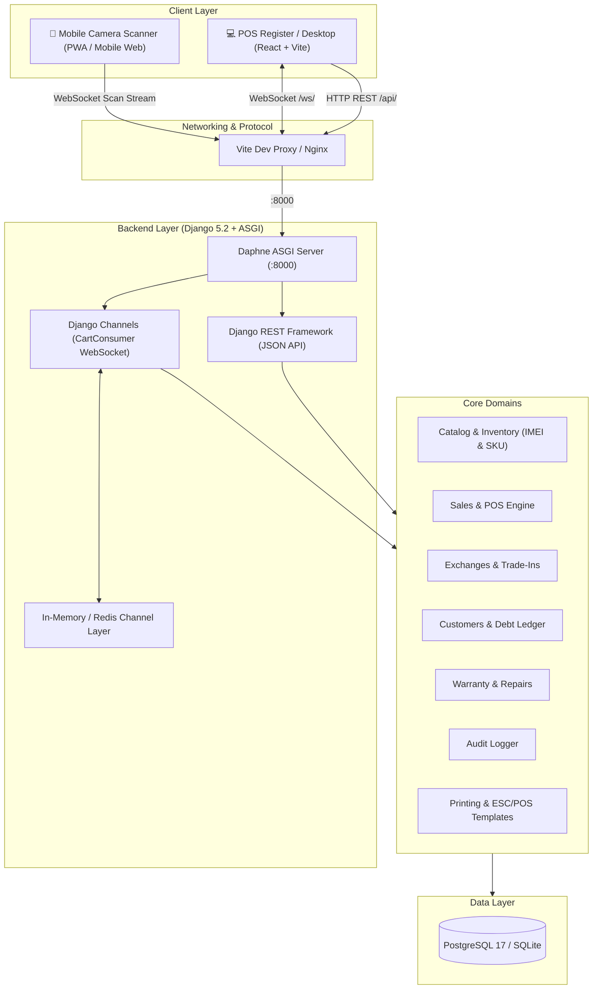

# 📱 Bighrissen Phone

<div align="center">


**Enterprise-Grade POS, Serialized Inventory & Workshop ERP for Electronics & Smartphone Retailers**

[](https://www.djangoproject.com/)
[](https://www.django-rest-framework.org/)
[](https://channels.readthedocs.io/)
[](https://react.dev/)
[](https://www.typescriptlang.org/)
[](https://vitejs.dev/)
[](https://tailwindcss.com/)
[](https://www.postgresql.org/)
[](https://www.docker.com/)

[Key Features](#-key-features) •
[Architecture](#-system-architecture) •
[Quick Start](#-quick-start) •
[Configuration](#-configuration) •
[Domains & Modules](#-core-domains--modules) •
[API & WebSockets](#-api--websocket-protocol) •
[Testing](#-testing--code-quality)

</div>

---

## 🌟 Overview

**Bighrissen Phone** is a retail management system and Point-of-Sale (POS) platform designed specifically for smartphone stores, electronics distributors, and repair centers.

Built from the ground up to solve the challenges of electronics retail, Bighrissen Phone integrates **individual IMEI tracking**, **live wireless phone barcode scanning**, **device trade-in appraisals**, **customer credit/debt accounts**, **after-sales warranty repair workflows**, and **thermal receipt generation** into a cohesive, responsive web application.

---

## 🚀 Key Features

- **⚡ Lightning-Fast POS Register**:
  - Barcode and SKU search with instant visual feedback and audio register chimes.
  - Multi-tender split payment: Cash, Credit Card, Bank Transfer, and Customer Credit (Debt).
  - Operator tagging for shift accountability and multi-cashier registers.
  - Real-time cart synchronization across screens.

- **📲 Wireless Smartphone Barcode & IMEI Scanner**:
  - Turns any mobile phone camera into an instant wireless POS handheld scanner without specialized hardware.
  - Communicates via real-time WebSockets (Django Channels & Daphne) directly to the active POS cart on the cashier's computer.
  - Multi-format scanning: Code 128, Code 11, QR, EAN-13, and serial numbers via `@zxing/library` & HTML5 camera capture.

- **🔍 Serialized Device & Inventory Tracking**:
  - Strict individual IMEI tracking for new, used, and refurbished smartphones, tablets, and computers.
  - Hardware health profiling: battery capacity (mAh & health %), cosmetic grading, storage, color, and supplier purchase cost.
  - Stock movement ledger with full traceability (Purchased, Reserved, Sold, Returned, Defective).

- **🔄 Trade-In & Device Exchanges**:
  - Built-in appraisal workflow for used customer devices.
  - Seamless trade-in credit calculation deducted from the new sale transaction in a single atomic operation.

- **💳 Customer Debt & Credit Management**:
  - Track customer balances, debt limits, and repayment histories.
  - Partial debt repayment collection directly from the POS interface with printed debt receipts.

- **⏳ Customer Reservations & Deposits**:
  - Reserve devices or accessories with custom deposit requirements and hold durations.
  - Concurrency-safe reservation activations preventing double-allocation of unique IMEI items.

- **🛠️ Repair Workshop & Warranty Management**:
  - Repair intake tickets, diagnostic assessments, customer issue notes, and technician assignment.
  - Automated warranty slips tied to device IMEIs with configurable duration rules per store settings.

- **🖨️ Thermal Receipt & Barcode Generation**:
  - Direct 80mm and 58mm ESC/POS compatible thermal receipt layout.
  - Dynamic barcode/QR label rendering using `python-barcode` and `jsbarcode`.
  - PDF export with client/store details, items, tax, and custom store policy footers.

- **🛡️ Immutable Audit Logging**:
  - Every financial transaction, stock movement, price override, and administrative update is immutably logged with user, IP, and timestamp.

- **🎨 Modern Dual-Theme UI**:
  - Sleek dark and light themes crafted with Tailwind CSS v4, glassmorphism, responsive navigation, and Lucide icons.
  - Localized with Moroccan Dirham (`MAD`), Casablanca timezone, and bilingual formatting support.

---

## 🏗️ System Architecture



---

## 💻 Tech Stack

### Backend
| Component | Technology | Version | Description |
| :--- | :--- | :--- | :--- |
| **Framework** | Django | 5.2.17 | High-performance Python web framework |
| **REST API** | Django REST Framework | 3.18.1 | Robust serialized JSON endpoints |
| **ASGI / Realtime** | Daphne & Channels | 4.2 / 4.3 | Asynchronous WebSocket and event bus |
| **Database** | PostgreSQL / SQLite | 17 / 3.x | Relational persistence with transaction safety |
| **Imaging & Barcodes** | Pillow / python-barcode | 12.3 / 0.16 | Receipt & label graphics generation |
| **Configuration** | django-environ | 0.14.0 | Twelve-factor environment management |

### Frontend
| Component | Technology | Version | Description |
| :--- | :--- | :--- | :--- |
| **Framework** | React | 19.2.8 | Declarative modern UI component architecture |
| **Language** | TypeScript | ~6.0.2 | End-to-end type safety |
| **Build Tool** | Vite | 8.3.0 | Next-generation frontend bundler with HMR |
| **Styling** | Tailwind CSS | v4.3.3 | Utility-first design tokens with dark mode |
| **State Management**| Zustand | 5.0.15 | Lightweight client state & session persistence |
| **Scanning** | @zxing/library | 0.23.0 | Mobile browser camera barcode reading |
| **Export & Print** | jsPDF & autoTable | 4.2 / 5.0 | Thermal receipt & invoice PDF synthesis |
| **Icons** | Lucide React | 1.51.0 | Consistent iconography |

---

## 📁 Project Structure

```text
bighrissen-phone/
├── backend/
│   ├── apps/
│   │   ├── audit/            # Audit trail & system security logging
│   │   ├── catalog/          # Brands, models, categories & specifications
│   │   ├── customers/        # Customer directory & debt ledger management
│   │   ├── exchanges/        # Device trade-in appraisals & exchange orders
│   │   ├── inventory/        # IMEI device items, accessories & stock movements
│   │   ├── payments/         # Multi-tender payment records
│   │   ├── printing/         # Barcode generation & thermal receipt templates
│   │   ├── refunds/          # Customer refund processing & approval
│   │   ├── reservations/     # Customer item deposits & reservation lifecycle
│   │   ├── returns/          # Return item intake & condition evaluation
│   │   ├── sales/            # POS transaction engine, cart & WebSocket consumers
│   │   ├── store_settings/   # Store metadata, warranty rules, currency & receipt config
│   │   ├── users/            # Custom User model, operator roles & permissions
│   │   └── warranty/         # Repair workshop tickets & warranty certificates
│   ├── config/               # Django settings, ASGI router, WSGI & URL routing
│   ├── Dockerfile            # Container definition for Django/Daphne service
│   ├── manage.py             # Django management CLI
│   └── requirements.txt      # Python dependencies
├── frontend/
│   ├── src/
│   │   ├── api/              # Axios API client & typed backend endpoints
│   │   ├── components/       # Reusable UI widgets (Modals, Badges, Tables, Inputs)
│   │   ├── hooks/            # Custom React hooks
│   │   ├── pages/            # View routes (POS, Inventory, Dashboard, Repairs...)
│   │   ├── store/            # Zustand state stores (auth, cart, theme, settings)
│   │   ├── utils/            # Barcode decoders, formatters & audio helpers
│   │   ├── App.tsx           # Route layout & authentication gatekeeper
│   │   ├── index.css         # Tailwind CSS v4 design system
│   │   └── main.tsx          # React application root
│   ├── package.json          # Node.js dependencies & scripts
│   └── vite.config.ts        # Vite build & reverse-proxy configuration
├── docker-compose.yml        # Orchestration for PostgreSQL & Backend
├── .env.example              # Sample environment variables
└── README.md                 # Project documentation
```

---

## ⚡ Quick Start

You can run Bighrissen Phone using either **Local Development Mode** (SQLite, instant setup) or **Docker Compose** (PostgreSQL production-like stack).

### Option 1: Local Development (Recommended for Fast Setup)

#### 1. Clone the repository
```bash
git clone https://github.com/mohamedbailla599/phone-retail-pos.git
cd phone-retail-pos
```

#### 2. Configure Environment Variables
Copy `.env.example` to `.env` in the root directory:
```bash
cp .env.example .env
```
Ensure `.env` contains:
```ini
USE_SQLITE=True
DJANGO_DEBUG=True
DJANGO_SECRET_KEY=django-dev-secret-change-before-production
DJANGO_ALLOWED_HOSTS=localhost,127.0.0.1
```

#### 3. Backend Setup (Python 3.12+)
```bash
cd backend

# Create virtual environment
python -m venv .venv

# Activate virtual environment
# Windows PowerShell:
.venv\Scripts\Activate.ps1
# Linux/macOS:
source .venv/bin/activate

# Install dependencies
pip install -r requirements.txt

# Run migrations
python manage.py migrate

# (Optional) Create superuser
python manage.py createsuperuser

# Start Daphne ASGI backend server
python manage.py runserver 8000
```

#### 4. Frontend Setup (Node 20+)
In a separate terminal window:
```bash
cd frontend

# Install Node dependencies
npm install

# Start Vite development server
npm run dev
```

The application is now live at:
- **Frontend App**: [http://localhost:5173](http://localhost:5173)
- **Backend API & Admin**: [http://127.0.0.1:8000](http://127.0.0.1:8000)
- **Django Admin Console**: [http://127.0.0.1:8000/admin/](http://127.0.0.1:8000/admin/)

---

### Option 2: Docker Compose (Full Stack with PostgreSQL 17)

To run the containerized backend and PostgreSQL database:

```bash
# Start backend and database services
docker compose up -d --build

# Run database migrations inside container
docker compose exec backend python manage.py migrate

# Create an administrator account
docker compose exec backend python manage.py createsuperuser
```

Then start the frontend locally with `cd frontend && npm run dev` pointing to `http://localhost:8000`.

---

## ⚙️ Configuration

Key environment variables configurable in `.env`:

| Variable | Default | Purpose |
| :--- | :--- | :--- |
| `USE_SQLITE` | `True` | Set `True` to use SQLite for rapid dev, or `False` for PostgreSQL |
| `POSTGRES_DB` | `bighrissen_phone` | Database name |
| `POSTGRES_USER` | `bighrissen` | Database username |
| `POSTGRES_PASSWORD`| `bighrissen_dev_password` | Database password |
| `POSTGRES_HOST` | `localhost` / `db` | Database host (`localhost` for local, `db` for Docker) |
| `POSTGRES_PORT` | `5432` | PostgreSQL port |
| `DJANGO_SECRET_KEY`| *(Required)* | Django cryptographic signing secret |
| `DJANGO_DEBUG` | `True` | Debug mode (`False` in production) |
| `DJANGO_ALLOWED_HOSTS`| `localhost,127.0.0.1`| Allowed HTTP Host headers |

---

## 🧩 Core Domains & Modules

### 1. Point of Sale (`apps.sales`, `POSPage.tsx`)
- Fast cart item additions via SKU, name, or IMEI scanner.
- Line-item discounts and overall order discount calculations.
- Multi-tender split payments (e.g., paying 500 MAD in Cash and 1,500 MAD on Credit/Debt).
- Instant printing dialog with thermal receipt rendering.

### 2. Device Inventory (`apps.inventory`, `DevicesPage.tsx`)
- Serialized device tracking with uniqueness constraint on **IMEI**.
- Condition categorization: `NEW`, `USED`, `REFURBISHED`.
- Battery capacity and battery health tracking (critical for refurbished iPhone and Android sales).
- Live statuses: `IN_STOCK`, `RESERVED`, `SOLD`, `RETURNED`, `DEFECTIVE`.

### 3. Bulk Accessories (`apps.inventory`, `AccessoriesPage.tsx`)
- Quantity-based non-serialized inventory.
- Automatic low-stock warnings when inventory drops below predefined safety levels.
- Barcode assignment for fast checkout.

### 4. Trade-In Exchanges (`apps.exchanges`, `ExchangesPage.tsx`)
- Appraise used customer phones (brand, model, condition, appraised value).
- Automatically deduct trade-in valuation from current POS cart.
- Seamlessly transition the trade-in item into inventory as a used device.

### 5. Customer Ledger & Debts (`apps.customers`, `CustomersPage.tsx`)
- Customer profile with phone, address, and debt summary.
- Complete ledger of credit purchases and installment payments.
- Automatic debt limit enforcement.

### 6. Reservations (`apps.reservations`, `ReservationsPage.tsx`)
- Hold high-demand devices for customers with down payments.
- Automatic expiration checks.
- Atomically converts to a POS sale or releases stock back to available inventory.

### 7. Repair Workshop & Warranty (`apps.warranty`, `RepairsPage.tsx`)
- Create repair tickets with customer issue descriptions, diagnostic findings, and estimated price.
- Assign technicians and track repair progress (`PENDING`, `IN_PROGRESS`, `COMPLETED`, `DELIVERED`).
- Issue official warranty certificates with expiration dates computed according to store rules.

---

## 📡 API & WebSocket Protocol

### REST Endpoints Overview

| Route | Method | Description |
| :--- | :--- | :--- |
| `/api/auth/login/` | `POST` | User authentication & session establishment |
| `/api/auth/me/` | `GET` | Current user profile, role, and active operator |
| `/api/sales/` | `GET`, `POST` | POS transactions and order checkout |
| `/api/inventory/devices/` | `GET`, `POST` | Device inventory (IMEI, specs, price, condition) |
| `/api/inventory/accessories/` | `GET`, `POST` | Accessory items & stock replenishment |
| `/api/customers/` | `GET`, `POST` | Customer profiles & debt balances |
| `/api/customers/<id>/pay-debt/` | `POST` | Register customer debt payment |
| `/api/exchanges/` | `GET`, `POST` | Device trade-ins and exchanges |
| `/api/reservations/` | `GET`, `POST` | Device reservations & deposit management |
| `/api/warranty/tickets/` | `GET`, `POST` | Repair workshop tickets |
| `/api/returns/` | `GET`, `POST` | Item returns and restocking |
| `/api/refunds/` | `GET`, `POST` | Refund issuance and approvals |
| `/api/settings/` | `GET`, `PATCH` | Store details, currency, warranty policies |
| `/api/printing/receipt/<id>/` | `GET` | Render thermal receipt preview |
| `/api/printing/barcode/<code>/` | `GET` | Generate barcode vector/image |

### Wireless Scanner WebSocket Protocol

The wireless scanner connects directly to the cashier cart channel:

```text
ws://<server-host>:8000/ws/cart/<transaction_id>/
```

#### Event Payloads:
- **Add Scanned Item to Cart**:
  ```json
  {
    "type": "cart.update",
    "barcode": "358742091234567"
  }
  ```
- **Cart State Broadcast**:
  ```json
  {
    "type": "cart.updated",
    "data": {
      "transaction_id": 42,
      "items_count": 3,
      "total_amount": "4500.00",
      "currency": "MAD"
    }
  }
  ```

---

## 🧪 Testing & Code Quality

### Backend Tests
Execute the Django unit and integration test suite:
```bash
cd backend
python manage.py test --keepdb
```

### Frontend Typecheck & Build
Validate TypeScript definitions and compile the production bundle:
```bash
cd frontend
npm run build
```

### Frontend Linter
Run Oxlint on the frontend codebase:
```bash
cd frontend
npm run lint
```

---

## 🧾 Receipt & Print Configuration

Store policies, addresses, and receipt headers are dynamically managed via the `/settings` interface:
- **Receipt Prefix**: Configurable invoice numbering (e.g. `BP-2026-XXXX`).
- **Currency**: Moroccan Dirham (`MAD`) by default.
- **Warranty Declarations**: Configurable warranty terms printed at the bottom of customer receipts.
- **Header & Contact Info**: Custom store name, contact numbers, and store address.

---

## 🔒 Security & Data Integrity

- **Strict Session Authentication**: CSRF protection enabled across all state-mutating endpoints.
- **Role-Based Access Control**: Granular roles (`OWNER`, `CASHIER`) controlling access to administrative settings, reporting, and discounts.
- **Double-Allocation Locks**: Concurrency protection ensuring no two cashiers can sell or reserve the same physical device IMEI simultaneously.
- **Protected Historical Data**: `django.db.models.PROTECT` applied on relational foreign keys to prevent orphan financial records.

---

## 📄 License

This software is developed for **Bighrissen Phone**. All rights reserved.

<div align="center">
  <sub>Built with ❤️ for modern retail operations.</sub>
</div>